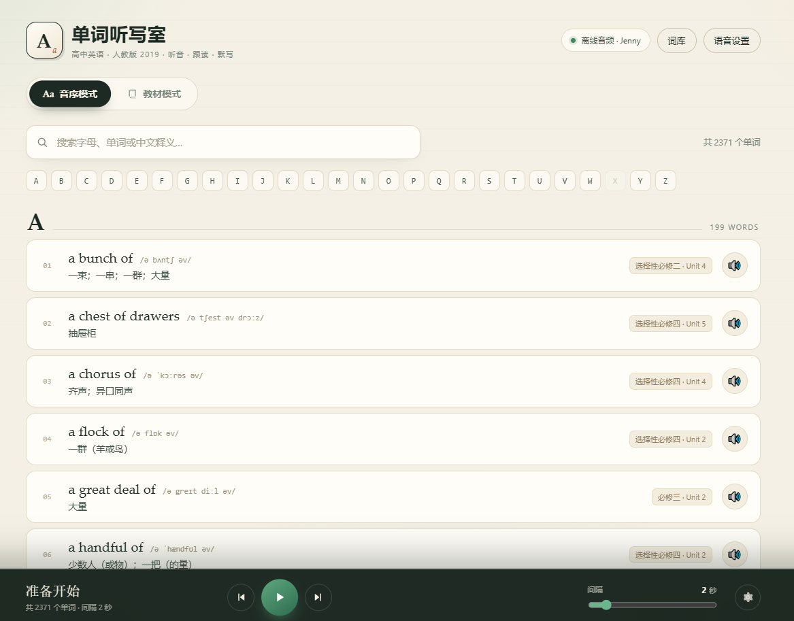

# highschool-english-words-pep
高中英语单词听写工具，单文件网页应用，支持音序/教材双视图、语音朗读

在线使用https://allwordsaudio.netlify.app/



## 功能

- **双视图浏览**：按音序（A-Z）或按教材单元（必修一 ~ 选择性必修四）两种维度查看词库
- **语音朗读**：调用浏览器 TTS 朗读单词与释义，可调语速、可调朗读间隔
- **听写模式**：只读英文不读中文，支持自动连播
- **自定义词库导入**：支持三种格式
  - JSON（推荐，结构最完整）
  - 管道符分隔文本：`单词|音标|释义`
  - 纯文本逐行导入
  - 导入时自动去重，并提供预览确认
- **离线朗读包**：当浏览器不支持语音合成时，可导出 txt 交给读屏软件朗读
- **本地保存**：进度与设置存于 localStorage，不上传任何数据

## 快速开始

### 方式一：直接使用

访问 https://allwordsaudio.netlify.app/ ，无需注册登录。

### 方式二：本地运行

1. 下载 `allwordsaudio.html`
2. 双击用浏览器打开即可

> 建议使用 **Microsoft Edge**，其中英文语音质量在主流浏览器中最佳。

## 词库导入格式

### JSON 格式（推荐）

```json
[
  {
    "word": "abandon",
    "phonetic": "/əˈbændən/",
    "meaning": "vt. 放弃；抛弃",
    "unit": "必修一 Unit 1",
    "order": 1
  }
]

管道符格式
每行一条，用 | 分隔，顺序为 单词|音标|释义：

abandon|/əˈbændən/|vt. 放弃；抛弃
ability|/əˈbɪləti/|n. 能力；才能

已知限制
发音质量依赖浏览器：本工具使用浏览器内置的 Web Speech API，不同浏览器、不同系统的语音效果差异较大。Chrome 与 Edge 表现较好，Safari 需先手动添加英文语音。
iOS Safari 限制：受系统策略限制，语音播放必须由用户手势触发，首次点击后才会正常发声。
音频文件匹配：若使用自定义音频文件，文件名需与单词一致（大小写、空格差异已做兼容处理）。

技术说明
纯前端实现，单个 HTML 文件包含全部 HTML / CSS / JavaScript，无任何构建步骤
无第三方依赖，无框架
数据全部存储在浏览器本地，不收集任何用户信息

词库来源
内置教材词库整理自高中英语教材词汇表，仅供个人学习使用。

开发说明
本项目在开发过程中全程使用了dsh AI 编码，功能设计、需求迭代与数据校对由作者本人完成。词库数据经过人工逐条核查与清洗。

许可证
MIT
